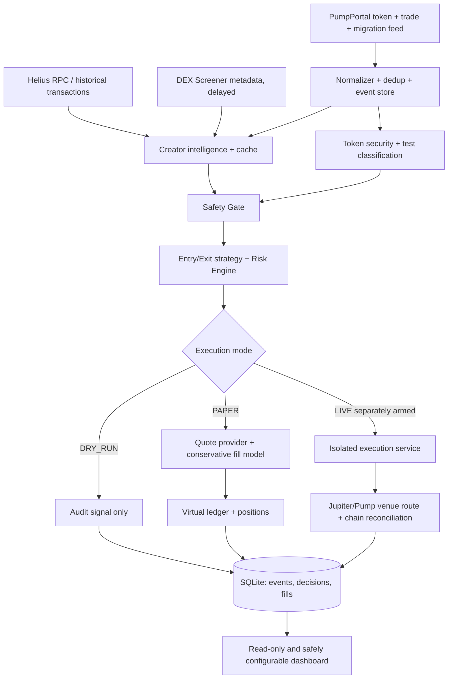

# Solana Sentinel — Complete Specification

> Generated documentation bundle. Individual files are authoritative; this is a convenience compilation.


---

<!-- SOURCE: README.md -->

# Solana Sentinel — Early Launch Intelligence & Trading Bot

**Status:** Architecture blueprint / implementation specification (not a working trading bot).  
**Language:** TypeScript, Node.js, SQLite; optional React dashboard.  
**Network:** Solana **mainnet** data for all modes; no live trading until separately armed.  
**Initial focus:** Pump.fun new-token detection, creator intelligence, anti-scam, test-token classification, and shadow trading.

> WARNING: Highly speculative, high-loss-risk token trading. A token that passes security checks can still lose 100% of its value. Never add a real wallet's private key to the scanner, dashboard, logs or repository. `DRY_RUN` is the default.

## Modes

| Mode | Mainnet market data | Virtual order fills | Real signing/sending |
|---|---|---|---|
| `DRY_RUN` | Yes | No | Never |
| `PAPER` | Yes | Yes, with conservative fill model | Never |
| `LIVE` | Yes | No | Only from isolated signer process after explicit approval |

`REPLAY` is a **data source** for repeatable historical tests, not a live trading mode. Do not describe offline replay as realtime paper trading.

## Read the documents in this order

1. [Product requirements](docs/00-PRODUCT-REQUIREMENTS.md)
2. [Architecture](docs/01-SYSTEM-ARCHITECTURE.md)
3. [Local setup](docs/02-SETUP-LOCAL.md)
4. [Provider integrations](docs/03-PROVIDER-INTEGRATIONS.md)
5. [Configuration](docs/04-CONFIGURATION.md) and [example config](config/default.yaml)
6. [Trading modes](docs/05-TRADING-MODES.md)
7. [Discovery & creator forensics](docs/06-DISCOVERY-FORENSICS.md)
8. [Risk/security rules](docs/07-SECURITY-RISK.md)
9. [Paper execution](docs/08-PAPER-EXECUTION.md)
10. [Live trading readiness](docs/09-LIVE-READINESS.md)
11. [Data model](docs/10-DATA-MODEL.md)
12. [Dashboard and API](docs/11-API-DASHBOARD.md)
13. [Tests and acceptance](docs/12-TESTING-ACCEPTANCE.md)
14. [Operations](docs/13-OPERATIONS.md)
15. [Implementation roadmap](docs/14-IMPLEMENTATION-ROADMAP.md)
16. [Agent implementation brief](docs/15-AGENT-IMPLEMENTATION-PROMPT.md)
17. [Architecture decisions](docs/16-ARCHITECTURE-DECISIONS.md)
18. [Event contracts](docs/17-EVENT-CONTRACTS.md)
19. [Replay methodology](docs/18-REPLAY-AND-VALIDATION.md)
20. [Threat model](docs/19-THREAT-MODEL.md)
21. [Official provider references](docs/20-REFERENCES.md)

## Configuration & starter templates

- `.env.example`: environment variables and secrets placeholders.
- `config/default.yaml`: baseline non-secret settings, conservative limits; **example only**.
- `.gitignore`: excludes `.env`, DBs, signer secrets, logs.

The repository provided here contains **documentation/config templates, not an executable application**. `pnpm`, `docker compose`, and REST endpoints below are **contracts for the implementor** and will work only after the code has been implemented.

## Non-negotiable invariants

1. `DRY_RUN`/`PAPER` must have **zero capability** to sign or submit transactions.
2. Failing providers / stale snapshots / unknown token state => `QUARANTINE` or `REJECT`, **never automatic BUY**.
3. Not enough liquidity for exit => never pretend to have sold in paper mode.
4. Historical decisions can only use data known by their decision timestamp/slot.
5. Every decision saves snapshot references, reason codes, config/version, timestamps, provider provenance.
6. `LIVE` must be an isolated deployment, separately authorized and protected by hard limits.
7. Dashboard can change safe settings, but **cannot arm live trading**.

## Definition of MVP

A single host can run realtime token discovery, perform basic creator/security checks, record `DRY_RUN` decisions and `PAPER` fills with SOL-denominated ledger accounting, and show auditable dashboards. No wallet secret is needed. Live implementation is a separate gated milestone.


---

<!-- SOURCE: AGENTS.md -->

# AGENTS.md — Instructions for coding agents

You are implementing **Solana Sentinel**. First read `README.md`, `docs/00`–`docs/05`, `docs/07`–`docs/12`, and `config/default.yaml`. Then inspect the existing code before making changes. Ask no redundant questions when specs provide answers.

## Priorities

1. Safety of execution boundaries; prevent unintended real swaps.
2. Correct and auditable on-chain data.
3. Honest simulation (no imaginary fills, no lookahead bias).
4. Reliability under rate limits, disconnects, retries and provider changes.
5. Clear API contracts and unit/integration tests.
6. Performance after correctness, without extra LLM calls on hot path.

## Mandatory implementation standards

- TypeScript strict, Zod validation at every provider boundary, lint/format, deterministic service composition and dependency injection.
- Use `bigint` or decimal-safe fixed precision for raw token amounts and SOL lamports; never floating point for settlement math.
- Store blockchain slot and timestamp, local received timestamp, idempotency key and source for every market event.
- Persist raw payload references for debugging (sanitized, bounded). Never log API keys or keypairs.
- Local timezone for UI may be Asia/Jakarta; persist timestamps in UTC.
- Reuse the same `RiskDecision` and `OrderIntent` contracts across modes.
- Use one PumpPortal WebSocket connection, manage subscription caps, backoff and re-subscribe on reconnect.
- Handle Pump bonding-curve phase, graduation, and PumpSwap phase distinctly. Check current official SDK docs before pinning versions.
- Do not infer shared control merely from a common exchange funding address.
- Social verification is advisory, not a hard safety override.
- Implement run-time audit events and tests before enabling live flows.

## Hard prohibitions

- Do NOT add signer/provider transaction submission imports to `packages/scanner`, `packages/strategy`, `packages/paper`, or dashboard.
- Do NOT allow frontend HTTP endpoints to flip an unarmed installation into `LIVE`.
- Do NOT use private keys from PumpPortal Lightning wallet in paper mode; treat its API key as sensitive because it can control a funded linked wallet.
- Do NOT count unmatched or rejected paper orders as filled.
- Do NOT hide risk warnings with a high opportunity score.
- Do NOT silently fallback to fake market price if quote is missing.

## Suggested packages

`apps/worker`, `apps/api`, `apps/web`, `apps/live-executor` (deploy separately), `packages/domain`, `packages/providers`, `packages/intelligence`, `packages/strategy`, `packages/paper`, `packages/storage`, `packages/config`, `packages/observability`.

## Agent workflow

1. Map requirements to code and state assumptions.
2. Implement a small, testable vertical slice.
3. Add fixtures, unit tests, integration tests, failure-mode tests, and docs updates.
4. Run strict typecheck, tests, lint, migrations; report outputs and unimplemented items.
5. Provide a change log and security review; never claim a test passed if it was not run.

For phased tasks and acceptance criteria use `docs/14-IMPLEMENTATION-ROADMAP.md` and `docs/15-AGENT-IMPLEMENTATION-PROMPT.md`.


---

<!-- SOURCE: docs/00-PRODUCT-REQUIREMENTS.md -->

# 00 — Product Requirements Document (PRD)

## 1. Vision

Detect new Solana launches early using public on-chain data, investigate creator behavior and token security, reject unsafe/test/spam tokens, and evaluate whether buying is worthwhile. Provide event-driven `DRY_RUN`, realistic `PAPER`, and separately armed `LIVE` operation. Profitability is **not guaranteed**.

## 2. Initial scope / non-goals

**P0:** Pump.fun launch events, creator/initializer attribution with confidence, token security and anti-test classification, SOL quotes, single virtual portfolio, paper orders/positions, risk gate, dashboard, replay/audit. Use mainnet data even in paper.

**P1:** PumpSwap after graduation, optional social intelligence, linked-wallet cluster analysis, additional entry/exit strategies, alerting, richer replay, stratified performance reporting.

**P2:** Real wallet support with isolated signer and guarded deployment, additional venues and route adapters, multi-wallet or multi-strategy.

**Out of scope in MVP:** guaranteed identification of scammers, privileged/insider info, actual mainnet trade submission, ultra-low-latency MEV strategies, automatic social scraping in violation of provider terms, arbitrary-token auto-buy.

## 3. User stories

- As an operator I can see new token launches within the observed realtime feed and why they are rejected.
- As an analyst I can inspect creator token history, linked funding addresses with evidence confidence and prior outcomes.
- As a paper trader I can simulate buys/sells against current on-chain state with fee/latency/slippage assumptions, no wallet signing.
- As an operator I can toggle analysis features/risk thresholds through validated config and see version of config per decision.
- As an operator I can compare 2/30/60-second entry strategies over the same recorded market events.
- As an operator I can see whether the stream is healthy and whether data/quotes were stale.
- As a future live operator I must perform a separate explicit CLI/deployment arming flow; the UI can only disarm.

## 4. Functional requirements

| ID | Requirement | Priority |
|---|---|---|
| FR-01 | Token creation and migration subscription with reconnect/resubscribe/dedup | P0 |
| FR-02 | Creator identity classification (`creator`, `payer`, `mint authority`, `funding`) | P0 |
| FR-03 | Cached historical reputation with evidence provenance and expiration | P0 |
| FR-04 | Token mint & extension checks incl. Token-2022 | P0 |
| FR-05 | Test/spam detection with `LIKELY_TEST`, `UNKNOWN`, `ORGANIC_CANDIDATE` | P0 |
| FR-06 | Decision gate: `REJECT`, `QUARANTINE`, `WATCH`, `BUY_ELIGIBLE` | P0 |
| FR-07 | `DRY_RUN`: record intents but never simulate a balance-changing fill | P0 |
| FR-08 | `PAPER`: real-time quote-based virtual ledger / entry & exit | P0 |
| FR-09 | SOL balance, positions, realized/unrealized PnL (exit-quote based) | P0 |
| FR-10 | Dynamic configuration with audit and safe reload boundaries | P0 |
| FR-11 | Observability, provider budget/limits and emergency pause | P0 |
| FR-12 | Shadow strategies and timestamp-correct replay | P1 |
| FR-13 | Social attribution with independent verification | P1 |
| FR-14 | `LIVE` with dedicated wallet/isolated signer, explicit arming | P2 |

## 5. Non-functional and safety requirements

- 99% of decisions and events should have reconstructable provenance in local testing (target, measure actual completeness).
- Target processing latency **after receipt** p95 under 2 seconds for cached creator analysis under nominal load; no promised chain-to-fill latency.
- No trade when chain account state is stale, missing, contradictory, or unsupported.
- Every network call has deadline, rate limit, circuit breaker, and structured error semantics.
- Multiple workers must be idempotent. Events can be duplicated and arrive out of order.
- Zero secret content in logs, telemetry, UI, database migrations, tests.
- No live signer dependency exists in the analysis/paper deployment.

## 6. Acceptance checkpoints

1. `DRY_RUN` remains read-only even with malformed mode/dashboard requests.
2. Paper buys and sells balance to the lamport; rejected exits do not realize fake PnL.
3. Router chooses Pump curve or migrated pool appropriately, with a deterministic failure for unsupported state.
4. Historical fixtures replay same outcomes deterministically when replay clock, config and random seed are fixed.
5. Risk decisions list explicit reason codes and evidence snapshots.
6. Live cannot be started from a config toggle alone; see `09-LIVE-READINESS.md`.

## 7. Success measurement

Track source-to-detection delay, decision latency p50/p95, missing/late events, % unknown creators, rejection false positives (only assess with later outcomes), risk rule frequencies, conservative paper expectancy, net PnL, max drawdown, simulated quote success ratio, quote freshness, slippage and fee sensitivity. Do not optimize win rate alone.


---

<!-- SOURCE: docs/01-SYSTEM-ARCHITECTURE.md -->

# 01 — System Architecture

## Data-flow diagram



## Bounded contexts

- **Ingestion:** maintain one PumpPortal socket, reconnect, persist checkpoints and normalized events, cap subscriptions.
- **Intelligence:** token and creator identity, past launches, wallet graph with evidence and cache invalidation.
- **Security:** deterministic per-token checks from chain state; unknown = not safe.
- **Strategy:** consumes immutable `MarketSnapshot` and `RiskReport`, produces `TradeIntent` independent of mode.
- **Execution:** `DryRunExecutor`, `PaperExecutor`, `LiveExecutor`; mutually exclusive capability profile.
- **Ledger:** append-only accounting; positions derived/reconciled; no floating-point settlements.
- **Control plane:** config version, admin changes, health, dashboard, local pause switch.

## Recommended directory layout

```text
apps/
  worker/             # new-token streaming, analysis, strategy
  api/                # health, audit, config API (no signing)
  web/                # React UI
  live-executor/      # optional, isolated service, NOT deployed in MVP
packages/
  domain/             # event schemas and order semantics
  providers/          # Helius, PumpPortal, DEX Screener, Jupiter adapters
  intelligence/       # creator/cache/wallet graph
  security/           # token safety + test token checks
  strategy/           # entry/exit/risk
  execution/          # interfaces and DRY_RUN executor
  paper/              # quote providers, simulation, virtual ledger
  storage/            # SQLite migrations / repositories
  config/             # Zod schema, config snapshots
  observability/      # metrics & logs
config/default.yaml
migrations/
fixtures/
tests/{unit,integration,replay,e2e}/
AGENTS.md
```

## Event and state boundaries

- `MarketEvent`: persisted with chain slot + upstream signature, source, received timestamp. Unique `(source, signature, event-index)` or stable synthetic ID.
- `TokenState`: `DISCOVERED → ANALYZING → {REJECTED | QUARANTINED | WATCHING | ELIGIBLE}`; revalidate as market changes.
- `OrderIntent`: `CREATED → RISK_CHECKED → {REJECTED | SUBMITTED}`; executor-specific transitions thereafter.
- `PAPER`: `QUOTE_REQUESTED → {UNFILLABLE | FILLED | EXPIRED}`. `FILLED` is simulated only.
- `LIVE`: `PREPARED → SIGNED → SUBMITTED → {CONFIRMED | FAILED | UNKNOWN}`. `UNKNOWN` requires reconciliation, not automatic resubmit.

## Architectural invariants

- Source ingestion never calls a live transaction method.
- Live signer and key storage are not available from worker/API processes.
- Ledger write and order state transition are in one transaction where possible.
- All on-chain prices are venue-, slot-, and timestamp-scoped.
- Provider adapters return typed `Result<T, ProviderError>` and include source metadata.
- Cache can accelerate historical context, but mint security must be checked for each new token.
- Use a durable queue only once one-process SQLite operations become a measurable bottleneck; do not introduce Redis by default.

## Latency engineering

Parallelize independent token and creator checks; use precomputed creator reputation; enforce max analysis timeout (quarantine on timeout). Track received_at vs chain slot timestamp separately. Never label hypothetical under-one-second targets as measured performance.


---

<!-- SOURCE: docs/02-SETUP-LOCAL.md -->

# 02 — Local Development Setup (Ubuntu / Arch / CachyOS)

This is the **planned setup for the app implementation**. The blueprint zip itself does not contain runnable app code.

## Prerequisites

- Linux workstation/VPS, Git, Node.js **current supported LTS** (pin actual tested version in `.nvmrc` once app exists), Corepack/pnpm, Python 3 for diagnostics, SQLite CLI, Docker optional.
- Network access to Helius RPC, PumpPortal WebSocket, DEX Screener HTTPS and Jupiter HTTPS.
- Already obtained: `HELIUS_API_KEY`, `PUMPPORTAL_API_KEY`, `JUPITER_API_KEY` (if available). DEX Screener public endpoints do not require credentials.
- SQLite stored on a persistent SSD; daily backups and disk alerting.

## Verify tools

```bash
node --version
corepack --version
pnpm --version
git --version
sqlite3 --version
```

## Initialize implementation workspace

```bash
mkdir solana-sentinel && cd solana-sentinel
# Copy files from this blueprint preserving the docs/ and config/ structure.
cp .env.example .env
chmod 600 .env
# Edit .env locally; never post keys into chat or commit them.
```

**For the coding agent:** create a pnpm workspace and the packages described in `01-SYSTEM-ARCHITECTURE.md`. Scripts after implementation should include:

```bash
pnpm install
pnpm db:migrate
pnpm test
pnpm typecheck
pnpm lint
pnpm dev:worker
pnpm dev:api
pnpm dev:web
```

Do **not** expect these commands to work until implementation adds `package.json`, scripts and migrations.

## Start-up milestones

1. **Provider health:** successful Helius JSON-RPC test and PumpPortal subscription; provider checks never print API keys.
2. **Discovery:** persist `subscribeNewToken` events. Dedup by signature/mint/slot.
3. **Research:** Creator history and mint state; store reason codes and confidence.
4. **DRY_RUN:** generate audit signals, zero balance mutations, no wallet.
5. **PAPER:** configure virtual starting SOL, send simulated quote requests only, record full ledger.
6. **UI:** consume read-only API, then implement safe settings editing.
7. **Production:** supervision, backups, TLS/reverse proxy, no exposed database port.

## Sanity checklist

- `APP_MODE=DRY_RUN` and `LIVE_TRADING_ENABLED=false`.
- No real-wallet keypair is present anywhere in process env, YAML, bind mounts, database or CI.
- `.env` is ignored by Git; accidental commits trigger secret rotation.
- RPC timestamps and log timestamps are normalized to UTC.
- Paper account currency SOL, initial lamports set and immutable after ledger first entry without a ledger adjustment event.
- All provider adapters can run in mock/fixture mode for tests.

## Provider command examples

```bash
# Public DEX Screener sample: replace <TOKEN_MINT> with a known mint.
curl -fsS 'https://api.dexscreener.com/token-pairs/v1/solana/<TOKEN_MINT>'

# Helius health and rate limits should be verified by code using the official RPC docs;
# do not paste secrets into shell history or command output.
```

## Note on Docker

Use Docker Compose **after** implementation creates `Dockerfile` for worker/API/web and tested volumes. Keep live-executor in a separate deployment/compose profile and host. Do not put live signer secrets in a shared compose file.


---

<!-- SOURCE: docs/03-PROVIDER-INTEGRATIONS.md -->

# 03 — Provider Integrations and Fallbacks

## PumpPortal — discovery + optional trade stream

- WebSocket: `wss://pumpportal.fun/api/data?api-key=<PUMPPORTAL_API_KEY>`.
- Subscribe: `subscribeNewToken`, `subscribeMigration`, `subscribeTokenTrade`, `subscribeAccountTrade`.
- **One socket** and dynamically update subscriptions; do not open a connection per mint.
- Creation/migration streaming is listed as free; trade/account streams are metered and may require linked wallet funding. Check provider pricing and enforce monthly event budgets.
- Security note: PumpPortal **Lightning API key may control its linked wallet**. Even for read-only data, treat it as a signing-capable secret; never fund that wallet with trading capital for MVP.
- Parse and validate event signatures, blockchain slot, mint, creator, tx type and amounts. Store unknown fields in redacted raw record for forward compatibility.
- On reconnect: use jittered exponential backoff, restore subscriptions, reconcile gaps from Helius where possible. At-most-once receipt is not guaranteed.

## Helius — on-chain source of truth / transaction history

- Use JSON-RPC and documented wallet/transaction APIs for: mint metadata, Token/Token-2022 state, parsed transactions, historic wallet actions, funding history, transactions for address, and account balance.
- Enforce allowed methods/credits, pagination, timeouts, retry budgets, and backoff on 429/5xx.
- For creator attribution, distinguish token creator claim vs deployer/transaction fee payer vs mint authority vs other wallet roles.
- Keep provenance: `{rpc_method, endpoint_label, signature, slot, fetched_at, provider_version}`.
- Prefer blockchain/decoded official program state over a third-party classification label.

## DEX Screener — supplemental market/social metadata

- Endpoint: `GET https://api.dexscreener.com/token-pairs/v1/solana/{tokenAddress}`.
- Useful for pool info, `liquidity`, `txns`, `volume`, links and DEX phase. Public API, rate limited.
- **Not authoritative at launch:** new Pump.fun tokens may not be indexed immediately; missing pair is NOT automatically a scam. Do not use DEX Screener alone for Pump curve pricing.
- Cache endpoint responses with short TTL; never use an old price to claim a live fill.

## Jupiter Swap V2 — routing and eventual live trading

- API base: `https://api.jup.ag/swap/v2`; documented `GET /order` and `POST /execute`.
- Jupiter `/order` can return quote-only without `taker`, but route absence or no buildable tx must be interpreted carefully.
- **Paper:** only quote path; no transaction signing and never call `/execute`.
- **Live:** only inside isolated live-executor; validate mint, route, min-out, fees, expiry and transaction before signing; reconcile signature on-chain.
- New Pump curve tokens may not have an immediately available Jupiter route; use official Pump SDK math / verified on-chain state rather than inventing a price.

## Pump.fun and PumpSwap official SDKs

- Use `@pump-fun/pump-sdk` and `@pump-fun/pump-swap-sdk` for supported market-state and trade/quote math when available.
- Pin versions only after checking official latest docs/IDL against supported programs; do not copy old constant-product formulas blindly. Pump protocol introduced v3 trades and v2 PumpSwap, multi-hop and negative virtual reserve handling in 2026.
- Treat migration as a state transition and invalidate old quote snapshots. Quote output includes fee assumptions and provenance; avoid double-charging fees.

## Provider fallback matrix

| Primary failure | Safe behavior |
|---|---|
| PumpPortal socket down | Pause discovery/entry; expose degraded health; reconcile gaps |
| Helius on-chain state missing | `QUARANTINE`; no BUY |
| DEX Screener unavailable | Skip supplemental metadata, continue on verified chain state where possible |
| Curve/pool quote unavailable | Reject/expire order; no paper fill |
| Jupiter `/order` unavailable | Do not use old quote or execute |
| Discord/X/website unavailable | Social status `UNVERIFIED`, never invent endorsement |

## Provider cost controls

Set `max_monitored_tokens`, `max_trades_stream_events_per_day`, per-provider rate limits, budget alert threshold, and adaptive unsubscribe policy. Track overages; stop costly subscriptions safely when reaching budget.


---

<!-- SOURCE: docs/04-CONFIGURATION.md -->

# 04 — Configuration Contract

See [`config/default.yaml`](../config/default.yaml) and [`.env.example`](../.env.example).

## Sources and precedence

1. Compiled safe defaults (`DRY_RUN`, `live disabled`).
2. Versioned YAML (non-secrets) loaded at boot.
3. Environment variables for secrets and deployment-level hard locks.
4. Whitelisted UI-overrides for **non-critical** analysis and strategy parameters only, stored with actor, timestamp, version.

Deployment hard locks (mode, live enablement, wallet/signer identity, chain network, hard loss/position caps) can **never** be loosened through API/UI. Runtime settings may further **tighten** risk. Restart required for mode changes. Never accept arbitrary JSON configuration keys or silent type coercion.

## Critical env controls

- `APP_MODE=DRY_RUN|PAPER|LIVE` — only startup; restart after any mode change.
- `LIVE_TRADING_ENABLED=false` — must be true at process startup for an independently approved live deployment, in addition to other checks.
- `LIVE_SIGNER_ENDPOINT` — allowed only inside separately deployed live executor; omit from scanner/paper worker.
- `HELIUS_API_KEY`, `PUMPPORTAL_API_KEY`, `JUPITER_API_KEY` — secrets, redacted.
- `APP_CONFIG_PATH=config/default.yaml`, `DB_PATH=./data/sentinel.db`.

## Config domains

- `discovery`: source, subscriptions, concurrent analysis cap, supported token programs.
- `intelligence`: max creator history depth, caching, wallet-graph confidence, external data cost limits.
- `security`: mint authority/extension policy, unknown handling, creator blacklist/evidence requirements.
- `strategy`: entry timing, opportunity score and scoring weights, min observations.
- `paper`: initial SOL, latency simulation, quote stale window, fee model, conservative slippage.
- `risk`: per-order max SOL, max exposure, position count, daily loss, max drawdown, maximum quote price impact.
- `observability`: health thresholds, budgets, event logging retention.

## Validation rules

- All percentages in config are **basis points** (100 bps = 1%). UI converts to percentage for display.
- Max loss and drawdown limits >0 and <100%, order sizing positive, exposure >= per-trade limit.
- Quote `max_age_ms` cannot be negative. Unknown/stale is disallowed for fills.
- Strategy weights total 100; `MIN_SCORE` within 0–100; overrides subject to schema and bounds.
- For `LIVE`, validate startup-only `live` manifest (`wallet allowlist`, SOL budget, chain ID, allowlisted venues) and explicit authorization. See 09.

## Configuration changes

1. Operator submits UI edit → validate patch against whitelisted schema.
2. Persist immutable config revision and actor / reason.
3. Apply only at documented safe boundary (next token decision), never mid-order.
4. Every decision saves `config_version`, `strategy_version`, `build_sha`.
5. Emergency pause may always be activated immediately, regardless of mode.

## Example mode selection (implemented app)

```bash
APP_MODE=DRY_RUN pnpm dev:worker
APP_MODE=PAPER pnpm dev:worker
# No direct example to launch LIVE: requires explicit runbook and guarded deployment.
```

These commands are intended post-implementation; this blueprint contains no runnable application code.


---

<!-- SOURCE: docs/05-TRADING-MODES.md -->

# 05 — Trading Modes: DRY_RUN / PAPER / LIVE

## Safety matrix

| Capability | DRY_RUN | PAPER | LIVE |
|---|---:|---:|---:|
| Listen to mainnet token/trade events | Yes | Yes | Yes |
| Creator/scam/social analysis | Yes | Yes | Yes |
| Produce trade signal | Yes | Yes | Yes |
| Create order intent and audit | Yes | Yes | Yes |
| Query mainnet quotes | Optional | Required | Required |
| Change virtual balances | **No** | Yes | **No** |
| Sign Solana transactions | **Impossible** | **Impossible** | Isolated signer only |
| Submit Solana transactions | **Impossible** | **Impossible** | Guarded sender only |
| Track real positions | No | No | Yes, reconciled on-chain |

## DRY_RUN

Purpose: verify detection/decision quality, reason codes and timing. It may calculate hypothetical price but must **not** create `paper_fills`, adjust virtual capital, or report realized PnL as if traded. Signal log stores `would_buy`, `would_sell`, `would_reject` with full context. No wallet.

## PAPER (real-time market simulation)

Use **mainnet data**, virtual SOL and token balances; reconstruct executable quote at simulated placement time, apply pessimistic constraints and log fill quality. No signature/transaction submission. Virtual funds must not grow without ledger events.

- `REALTIME_PAPER`: event timestamps advance with live clock and live quotes.
- `REPLAY_PAPER`: same engine, deterministic recorded events and historical market snapshots. These are not interchangeable: never query current quote while replaying historical trades.
- Mark equity-to-market using **exit quotes** for position size, not last trade price alone.
- When sell cannot be quoted or liquidity vanishes, status `EXIT_UNAVAILABLE` and exposure remains.

## LIVE

Only after `09-LIVE-READINESS.md` signoff. Uses actual wallet-specific accounting and chain confirmations. Same shared strategy and risk code but isolated deployment, explicit arming, separate signer, and per-intent risk checks immediately before signing. Dashboard must not arm it. Missing chain confirmation -> `UNKNOWN`, reconcile signature and balance first.

## Execution interface contract

```ts
export type TradingMode = 'DRY_RUN' | 'PAPER' | 'LIVE';
export type Side = 'BUY' | 'SELL';
export type OrderResult = {
  status: 'WOULD_TRADE' | 'SIMULATED_FILLED' | 'CONFIRMED' |
          'REJECTED' | 'UNFILLABLE' | 'EXPIRED' | 'UNKNOWN';
  mode: TradingMode;
  orderId: string;
  amountInRaw: bigint;
  amountOutRaw?: bigint;
  txSignature?: string; // only LIVE
  reasonCodes: string[];
};
export interface Executor {
  execute(intent: TradeIntent, snapshot: MarketSnapshot): Promise<OrderResult>;
}
```

`DRY_RUN` returns only `WOULD_TRADE`/`REJECTED`. `PAPER` returns `SIMULATED_FILLED`/`REJECTED`/`UNFILLABLE`/`EXPIRED`. `LIVE` uses `CONFIRMED`/`UNKNOWN`/`REJECTED`/`EXPIRED` and stores actual tx signature. Validate this contract in tests.

## Required independent permission layers for LIVE

1. Build artifact: `apps/live-executor` package deployed separately.
2. Startup configuration: mode `LIVE` + locked `LIVE_TRADING_ENABLED=true` in live environment, never dashboard.
3. Explicit local CLI/admin approval (short-lived arming session, logged).
4. Signer allowlist and wallet balance/risk caps.
5. Kill switch at both worker and live-executor, fail-closed by default.


---

<!-- SOURCE: docs/06-DISCOVERY-FORENSICS.md -->

# 06 — Discovery, Creator Forensics and Test Token Detection

## 1. Token launch pipeline

1. Receive `subscribeNewToken` event, persist raw+normalized metadata and slot.
2. Dedup `(mint, creation_signature)` and identify Pump program/market phase.
3. Identify distinct `initiator`, `fee_payer`, `claimed_creator`, `mint_authority`, `funding_wallet`, `metadata_update_authority`. Unknown roles remain UNKNOWN.
4. Fetch mint account/token program and minimum necessary on-chain security state.
5. Lookup creator profile (cached historical launches, measured outcomes and verified warning evidence).
6. Queue deeper forensic exploration if profile absent/stale; timeout => quarantine rather than permit buy.
7. Start observation window (30/60/120 sec configurable) and collect initial independent buying/volume signals.
8. Produce safety and opportunity reports. Save snapshots and decision reasons.
9. Monitor migration, authority changes, concentration, price/volume, and anomalies until watch horizon.

## 2. Creator analysis signals

| Signal | Evidence | Caution |
|---|---|---|
| Historical launches | Mint events linked to initiator/creator with source signatures | A creator may use multiple wallets |
| Token launch outcomes | Timed liquidity/price/tx records | Low liquidity is not necessarily malicious |
| Developer sell pattern | Historical creator-associated wallet trades | Distinguish routine sells vs coordinated dumps |
| Funding ancestry | Transfers + depth/time confidence | CEX hot wallet is weak commonality evidence |
| Wallet cluster | Repeated timed funding, buys, sells, shared controllers | Never assert common ownership from a single edge |
| Test/spam pattern | Burst mint frequency and repeated metadata | New genuine projects may test |
| Liquidity events | Verified pool/curve updates | Curve and PumpSwap must be evaluated separately |

## 3. Reputation record design

- `creator_id`, `wallet_role`, `evidence_signatures`, `labels`, `confidence` (0–1), `known_launches`, `assessed_outcomes`, `last_refreshed_slot`.
- Labels: `UNKNOWN`, `LOW_RISK_HISTORY`, `SUSPICIOUS_PATTERN`, `CONFIRMED_ABUSE` (only with documented criteria).
- Never use subjective label `SCAMMER` as a proven fact solely from clustering. Preserve investigator trace.
- Apply decay/re-evaluation and allow false-positive resolution, with audit trail.

## 4. Test token classifier

Feature signals: burst launches by same creator, duplicate metadata, names containing TEST/DEMO/DEV, near-zero organic buyer participation, repeated tiny swaps, no sustained market interest, same-wallet buy/sell loop.

Return `LIKELY_TEST`, `UNKNOWN` or `ORGANIC_CANDIDATE`. Each output carries evidence and confidence. `UNKNOWN` must not be auto-approved. Classification is heuristic, not a proof of maliciousness.

## 5. Optional social intelligence

- Collect social links from verified on-chain metadata or DEX Screener only as leads.
- Test if a known official channel independently announces the exact mint address.
- Assess timing and source provenance, not merely follower counts or verified badges.
- Social fetches run asynchronously, bounded by cost/time. Incomplete social analysis is `UNVERIFIED`, not `LEGIT`.
- Social score cannot override critical token or wallet risk failures.

## 6. Anti-poisoning

Creator reputation updates require blockchain evidence/independent confirmation. Keep separate tables for raw observations and inferred labels. Never let a freshly minted token's own metadata declare the creator trustworthy.


---

<!-- SOURCE: docs/07-SECURITY-RISK.md -->

# 07 — Security Gate, Opportunity Score and Risk Engine

## Decision levels

- `REJECT`: confirmed hard-block condition.
- `QUARANTINE`: insufficient/contradictory/stale evidence or unsupported token features.
- `WATCH`: pass mandatory checks but no actionable entry opportunity yet.
- `BUY_ELIGIBLE`: mandatory checks pass **and** an independent strategy/risk decision allows entry.

## Mandatory token checks

- Validate token program type, mint supply/decimals, mint authority and freeze authority.
- For Token-2022, inspect permanent delegate, transfer hook (including program allowlist and sellability), transfer fees, non-transferable, default account state and other relevant extensions.
- Classify mint/pool/curve phase correctly; verify venue program and accounts.
- Measure creator + suspected cluster exposure; confidence-weighted, do not overclaim wallet ownership.
- Estimate effective **sell** output and price impact for intended size; handle quote unavailable as `QUARANTINE` or `UNFILLABLE`.
- Flag creator prior malicious outcomes with verifiable signatures; suspected patterns usually add risk rather than automatic confirmed-scam labels.
- Reject token if cannot establish safe transfer/sell route with current supported token program and venue.
- Inspect whether current token resembles testing/spam launch; unknown classification should not be treated as organic.

## Hard gate defaults

| Reason code | Policy | Note |
|---|---|---|
| `MINT_AUTHORITY_UNSAFE` | REJECT | Unless a reviewed, explicitly allowed authority pattern |
| `FREEZE_AUTHORITY_UNSAFE` | REJECT | Similar exception policy |
| `PERMANENT_DELEGATE_UNTRUSTED` | REJECT | Can authorize transfers or burns |
| `TRANSFER_HOOK_UNSUPPORTED` | QUARANTINE/REJECT | Could restrict transfers |
| `TRANSFER_RESTRICTION` | REJECT | Cannot transfer/sell |
| `CREATOR_CONFIRMED_ABUSE` | REJECT | Evidence standard required |
| `EXIT_QUOTE_UNAVAILABLE` | QUARANTINE | Do not fill paper buy without exit coverage |
| `DATA_STALE` / `PROVIDER_TIMEOUT` | QUARANTINE | Fail closed |
| `LIKELY_TEST_TOKEN` | QUARANTINE | Optional exclusion by strategy |
| `LOW_LIQUIDITY` / `HIGH_PRICE_IMPACT` | REJECT entry | Position-size dependent |
| `LOSS_LIMIT_REACHED` / `KILL_SWITCH` | REJECT entry | Global hard stop |

Token program semantics vary: a standard Pump.fun token and a custom Token-2022 mint must not be graded with identical assumptions.

## Opportunity score (only after hard gate)

Example initial score: `creator_history 30`, `token_security 25`, `launch_behavior 20`, `exit_liquidity 15`, `social_confidence 10`, total 100. If social disabled, re-normalize weights **only**; never turn missing critical security data into zero-risk.

`score >= 80` is a starting experimental threshold, not calibrated statistical evidence. Version model and thresholds; run shadow experiments before optimizing.

## Risk policy (illustrative conservative defaults)

- Max notional per trade: 0.05 SOL.
- Max total exposure: 0.20 SOL.
- Max open positions: 3.
- Max daily loss: 0.10 SOL or configurable fraction of starting equity, whichever is stricter.
- Max portfolio drawdown: 500 bps (5%).
- Max buy/sell price impact: 300 bps (3%) and slippage tolerance 200 bps (2%), subject to venue constraints.
- Reject order if market event older than configured TTL, market state changed before fill, fee estimate unavailable, or quote too old.
- Emergency stop blocks new buys and optionally triggers *separately controlled* risk-managed liquidation; liquidation may be impossible.

**These defaults are placeholders to adjust through experiments, not financial recommendations.**

## Entry/exit policies

Entry selection `FAST` only for cached creator evidence plus full mandatory current-token check; `VALIDATED` observes trade behavior 30/60/120s. Exit may use time-based, trailing guard, risk cut, or suspected malicious activity detection, all after evaluating sell feasibility. Stop loss is not guaranteed to execute if trading is frozen or liquidity vanishes.

## Audit report example

```json
{
  "mint": "<token-mint>",
  "decision": "QUARANTINE",
  "reasonCodes": ["CREATOR_HISTORY_UNKNOWN", "DATA_STALE"],
  "criticalChecksPassed": false,
  "opportunityScore": null,
  "configVersion": "sha256:...",
  "observedSlot": 123456789,
  "decisionAtUtc": "2026-10-31T12:00:00Z"
}
```


---

<!-- SOURCE: docs/08-PAPER-EXECUTION.md -->

# 08 — Real-Time Paper Trading: Fill Model & Ledger

## Objective

Simulate trading using **mainnet state available when an order would arrive**, not an arbitrary last-traded price. Keep it conservative. A simulated success is not a guarantee of real execution.

## Clock and timeline

- `observed_slot/time`: event origin on-chain.
- `received_at`: time local worker received event.
- `decision_at`: after intelligence/risk completed.
- `intent_at`: order request created.
- `simulated_arrival_at`: intent time + configured execution latency (deterministic seeded distribution or fixed delay).
- `quote_at/slot`: state used for indicative trade output.
- `fill_at`: simulated execution time; must never precede intent/arrival/quote.

No lookahead. In replay, use recorded snapshots available at matching simulated time; **never query current mainnet for a historical trade**.

## Venue-specific quotes

1. On Pump curve, load account/global fee data and compute official compatible expected in/out and price impact for order size from same account slot. Handle protocol upgrades and multi-hop quote mint / signed virtual reserve adjustments if supported; otherwise do not fill.
2. Post-migration, read PumpSwap pool state/fees and use supported SDK quote. Migration invalidates curve cache.
3. If Jupiter supports the pair, a `GET /swap/v2/order` quote-only (no taker) may inform price; no execute endpoint in paper.
4. Every quote captures source, route/venue, as-of slot, freshness, fees included and validation status.

## Conservative paper buy algorithm

1. Gate/risk passes and available virtual SOL covers order and fees.
2. Make `OrderIntent` immutable with idempotency key and requested exact-input SOL lamports.
3. Wait simulated latency; fetch **fresh** venue state and compute exact-in quote.
4. Reject if unsupported venue, stale state, high price impact, insufficient seller exit liquidity, or slippage beyond bounds vs pre-intent reference.
5. Apply modelled adverse fill adjustment conservatively (never improve output arbitrarily), account for protocol/router/network/priority/ATA rent where applicable; **do not double-count embedded fees**.
6. Atomically append debit/credit ledger entries and `SIMULATED_FILLED` with raw amounts, cost basis and quote provenance.

## Conservative paper sell algorithm

1. Confirm virtual position size from ledger and venue capability.
2. Fetch fresh exact-input sell quote for actual held amount after simulated latency.
3. If no sell route or insufficient exit liquidity: `EXIT_UNAVAILABLE`; **position remains open** and account does not credit imaginary proceeds.
4. Account for slippage/fees and update raw token/SOL ledger and realized PnL only on simulated fill.

## Order lifecycle

`CREATED → RISK_CHECKED → QUOTE_REQUESTED → {SIMULATED_FILLED | REJECTED | EXPIRED | UNFILLABLE}`.

`DRY_RUN` **never** writes `SIMULATED_FILLED` or mutates virtual ledger.

## Ledger & PnL mathematics

Use lamports and raw token `bigint`, not floating point. Keep separate debits/credits and fee entries.

```
realized_pnl_lamports = net_sell_proceeds_lamports
                         - allocated_buy_cost_basis_lamports
unrealized_pnl = current_sell_quote_net_proceeds - remaining_cost_basis
```

If current sell quote missing, mark valuation `UNPRICEABLE`; don't show a fake positive mark. Daily loss and max drawdown must use conservative realized + reliable unrealized estimates, with severe `UNPRICEABLE` state blocking new risk.

## Advanced realism / evaluation

- Log best-case quote, conservative quote and paper filled output separately.
- Measure quote success, rejected exits, fee sensitivity, latency sensitivity, price-impact by order size.
- For quote availability, distinguish `NO_ROUTE`, `RATE_LIMIT`, `VENUE_UNSUPPORTED`, `STALE`, `NETWORK_TIMEOUT`.
- Use same recorded stream to compare FAST 2s vs VALIDATED 30s/60s/120s with independent virtual accounts and no future leakage.
- Simulated transactions do not affect market prices; production performance can diverge due to actual fill competition and transaction landing behavior.

## Validation fixtures

- Curve trade with fee-inclusive quote and fixed decimals.
- Curve migration to PumpSwap while a buy intent is pending.
- Token cannot sell after buy; no phantom PnL.
- RPC timeout, stale state, missing fields, duplicate events.
- Very small token units and overflow attempts; all accounting remains exact.
- Fee double-count test.


---

<!-- SOURCE: docs/09-LIVE-READINESS.md -->

# 09 — Live Wallet Readiness and Safe Enablement

**Current status:** NOT IMPLEMENTED. The blueprint is ready for a future live executor; nothing in this package should transact.

## Architecture

- Deploy `apps/live-executor` as separate process/container/host with signer access.
- Analysis worker and dashboard communicate only signed/validated intent through authenticated message channel.
- Operator provides **dedicated limited-balance wallet**, never primary wallet. Prefer a secure key manager / protected signer over raw `.env` key in production.
- PumpPortal Lightning API key can trade with its linked wallet: do not grant this credential to public API; use separate data/feed account where possible.
- Strict allowlist of network (`mainnet-beta`), wallet public key, programs, DEX routes, mints if needed, max fees, transactions/time, daily notional and amount per swap.

## Explicit arming flow

1. Implementor enables live feature at build/deployment policy, not only YAML.
2. Operator passes all preflight checks: no stale RPC, chain ID verified, signer reachable, balance cap, budget cap, kill switch tested, logging healthy.
3. Operator invokes local privileged CLI `sentinel live arm --wallet <pubkey> --budget-sol <max>` (planned command, not provided), confirms irreversible risk, and receives short-lived capability approval. Never store arm token in DB/frontend.
4. Signer independently validates capability, transaction structure, mint/venue allowlists and risk snapshot TTL at **signing time**.
5. Emergency stop or auth expiry disarms immediately; all restarts come up disarmed.

## Risk control / transaction lifecycle

- Re-check current balances/positions on-chain before each live transaction; avoid relying on paper ledger.
- Simulate preflight where provider/venue supports it, but simulated success is not guarantee of landing.
- Sign only if immutable order intent and fresh quote meet hard caps.
- Send once with idempotency signature. On timeout store `UNKNOWN`, reconcile signature on-chain before retry. Avoid duplicate submission.
- Record actual transaction signature, fees, execution price and post-trade token balances.
- Handle ATA creation/rent, wrapping SOL, blockhash expiry, priority fee/cost ceiling, failed tx and congestion.
- Withdrawal/send to arbitrary address is **not** part of the live trader. Disable management operations beyond swaps to allowlisted routes.

## Promotion gate before live

- Full unit/integration/e2e security suite passing, static scan and dependency review.
- ≥ several hundred closed simulated trades (benchmark goal, not statistical proof), with verified non-negative net expectancy after conservative fees and realistic latency; significant sample by market regime.
- Repeated replay without lookahead, reconciliation of positions and no ledger drift.
- Canary live tests with very small capped exposure only after explicit operator decision.
- Operator understands rug-pull/liquidity/MEV risks and the inability of a stop-loss to guarantee exit.

## Never do

- Do not let `PATCH /settings` set `APP_MODE=LIVE`.
- Do not expose signer keys through application APIs, browser UI, metrics, errors, or logs.
- Do not share signer process environment with third-party data-stream credentials.
- Do not automatically re-arm on container restart.


---

<!-- SOURCE: docs/10-DATA-MODEL.md -->

# 10 — Data Model (SQLite for MVP)

## General conventions

- Use migrations, unique constraints, WAL mode, FK enforced, bounded retention, periodic backups.
- Timestamps ISO-8601 UTC or integer epoch millis; blockchain slot stored as integer separately.
- Store amount in raw integer units as **decimal strings** in SQLite (or typed reversible binary), not IEEE float. Do conversions in `bigint`.
- Version every decision/config/strategy and keep immutable audit records.

## Initial tables

| Table | Key fields | Notes |
|---|---|---|
| `market_events` | `id`, `source`, `signature`, `event_idx`, `mint`, `slot`, `received_at`, `payload_ref` | Append-only, dedup key |
| `tokens` | `mint PK`, `program_id`, `created_slot`, `creator_id`, `market_phase`, `metadata` | Distinguish phase |
| `wallets` | `pubkey PK`, `first_seen`, `last_seen`, `roles` | Public keys only |
| `wallet_links` | `src`, `dst`, `type`, `confidence`, `evidence`, `observed_at` | Evidence-backed graph |
| `creator_launches` | `creator_pubkey`, `mint`, `created_at`, `outcome_status`, `outcome_asof` | Avoid hindsight |
| `creator_reputation` | `creator_pubkey`, `computed_at`, `asof_slot`, `scores`, `flags`, `evidence` | Cache with TTL |
| `security_reports` | `id`, `mint`, `asof_slot`, `checks`, `hard_block`, `quality` | Snapshot |
| `social_reports` | `id`, `mint`, `source`, `verification_status`, `evidence` | Optional |
| `decisions` | `id`, `mint`, `mode`, `status`, `reason_codes`, `config_version`, `snapshot_refs` | Immutable |
| `orders` | `id`, `intent_id`, `mode`, `side`, `amount_raw`, `status`, `quote_id`, `idempotency_key` | Full lifecycle |
| `quotes` | `id`, `venue`, `phase`, `slot`, `amount_in`, `amount_out`, `fee_breakdown`, `quote_at` | No stale reuse |
| `virtual_wallets` | `id`, `strategy_id`, `initial_sol_raw`, `created_at` | Paper only |
| `ledger_entries` | `id`, `wallet_id`, `order_id`, `asset_mint`, `delta_raw`, `type` | Append-only |
| `positions` | `wallet_id`, `mint`, `quantity_raw`, `cost_basis_raw`, `status` | Derived, reconcile |
| `live_transactions` | `order_id`, `signature`, `chain_status`, `actual_fee_raw`, `reconciled_at` | Live only |
| `strategy_runs` | `id`, `name`, `mode`, `config_hash`, `build_sha` | Shadow/replay attribution |
| `config_revisions` | `hash`, `actor`, `changed_at`, `validated_json`, `reason` | No secrets |
| `service_health` | `service`, `at`, `status`, `lag_ms`, `error_code` | Operational |

## Constraints and queries

- `market_events` unique `(source, signature, event_idx)` when signature exists; deterministic fallback for non-signature launch events.
- `orders.idempotency_key` unique across mode and strategy run.
- `ledger_entries` cannot be updated or deleted through API; corrections are compensating entries.
- Use atomic order fill + ledger write in one SQLite transaction.
- Index `(mint, slot)`, `(creator_pubkey, created_at)`, `(mode, status, created_at)`, `(wallet_id, asset_mint)`.
- Wallet links store `confidence` + `evidence`, no unsupported ownership assertions.

## Domain invariants

- No paper ledger mutation for DRY_RUN or LIVE.
- Paper buy debit and token credit plus applicable fees always balance.
- Ledger cannot create negative available cash without explicit margin design (not in MVP).
- Realized PnL only from completed sells with persisted quote/fill provenance.
- `UNPRICEABLE` positions remain part of risk exposure rather than disappearing from totals.

## Retention plan

Keep minimal normalized market events and decisions long enough for replay; rotate raw provider payload after configurable retention once references are verified. Back up DB with consistent SQLite backup mechanism, encrypt off host, test restoration monthly.


---

<!-- SOURCE: docs/11-API-DASHBOARD.md -->

# 11 — Dashboard and Internal API Contract

## UI pages

1. **Overview:** mode, stream health, scan count, token counts per risk status, risk budget, PnL if PAPER/LIVE.
2. **New Tokens:** live table mint, name, source, age, creator, phase, status, score, latency, reason codes.
3. **Token Detail:** authoritative mint/program state, creator analysis, linked-wallet graph with uncertainty, social evidence, market snapshot, decision trace.
4. **Creator Intelligence:** wallet profile, launch history, evidence signatures, confidence and time of assessment.
5. **Paper Portfolio:** virtual SOL, positions, cost basis, sell-quote valuation, realized/unrealized PnL and unpriceable exposure.
6. **Trades & Decisions:** all intents, quote reports, fills/no-fills, rejected decisions, fee breakdown, latency.
7. **Risk & Strategy:** config revisions and allowed hot-reload fields, pause switch, read-only locked caps.
8. **System:** provider health, reconnects, stale data, costs/quotas, DB backups, current build and configuration version.

## Proposed REST routes (to be implemented)

```http
GET    /api/health
GET    /api/status
GET    /api/tokens?status=WATCH&limit=50
GET    /api/tokens/:mint
GET    /api/creators/:pubkey
GET    /api/decisions?mint=<mint>
GET    /api/portfolio/paper
GET    /api/orders?mode=PAPER
GET    /api/config
PATCH  /api/config/strategy     # only safe allowlist fields
POST   /api/control/pause      # requires admin auth
POST   /api/control/resume     # after preflight, not LIVE arming
GET    /api/events/stream      # SSE event updates
```

## Security / UX rules

- The UI may request DRY_RUN/PAPER mode change as **pending restart** only; active mode is read from server at boot, not inferred from selected option.
- UI **cannot** set LIVE, upload key material, arm signer, or change hard loss caps upward.
- Auth + CSRF protection for mutating endpoints, audit actor, rate limit. CORS deny unless configured.
- Display `SIMULATED` on all paper fills/returns. Never show simulated and real PnL mixed.
- Distinguish API `UNKNOWN` vs false/zero. Evidence provenance and timestamp visible.
- Show alert when quote is stale, stream disconnected, social evidence missing, token migrated, or valuation unpriceable.
- New-tokens table should be virtualized/limited rather than subscribing every token forever.

## Event stream

SSE event types: `token.discovered`, `token.analyzed`, `token.decision`, `order.status`, `portfolio.changed`, `provider.health`, `config.changed`.

Every event contains `eventId`, UTC timestamp, mode, relevant resource ID and config version; never contain secrets or private key material.


---

<!-- SOURCE: docs/12-TESTING-ACCEPTANCE.md -->

# 12 — Testing, Validation and Acceptance Criteria

## Unit tests

- Strict config schema: unsafe values rejected and no `LIVE` via UI override.
- Raw token amount scaling, lamports conversion and arithmetic safe at extreme values.
- Token security checks across Token Program and Token-2022 extensions; unsupported extension fails closed.
- Creator reputation confidence and CEX-funding false-positive guard.
- Test token classifier with fixtures and uncertainty handling.
- Full reason-code taxonomy and immutability.
- Quote freshness, max slippage, fees (no double count), exact-in curves, pool migration.
- Ledger balances and realized PnL exact across partial fills, partial exits, rejections, and unavailable liquidity.

## Integration tests (mock providers + recorded responses)

- WebSocket connection, reconnection, resubscribe, duplicate/out-of-order events, event budget cap.
- Helius 429/5xx/timeout, pagination, malformed transaction payload.
- DEX Screener missing pool data not classified as scam by itself.
- Jupiter quote-only returns no route and paper does not sign or call execute.
- Subscriptions automatically unsubscribe after expiration/analysis cap.
- SQLite crash/restart resumes without duplicate ledger writes.

## Security and mode separation tests

- `DRY_RUN`/`PAPER` dependencies contain no signer and no transaction-sending credentials.
- `APP_MODE=PAPER` with `LIVE_TRADING_ENABLED=true` still cannot send (invalid combination rejected).
- API `PATCH` tries to set LIVE / change signer / lift hard caps → 403/400 + audit event.
- Restart of live-executor always disarmed; expired arming token blocks trade.
- Loss limits, global kill switch and stale market snapshots reject new entries.
- Secret leak scan in logs, HTTP responses, exception paths, Git history.

## Realtime evaluation

- Compare observed event receipt delay, analysis p50/p95 and quote p50/p95.
- Save `observation_window` variations 2s/30s/60s/120s with isolated virtual wallets.
- Minimum test objective: several hundred closed trades across multiple dates/market regimes (not enough to guarantee profit).
- Evaluate confidence intervals, distribution of loss, failure-to-exit frequency and PnL sensitivity to latency and price impact.
- Always report gross vs net after fees; mark `UNPRICEABLE` positions separately.

## Acceptance gates by phase

| Phase | Must demonstrate |
|---|---|
| P0 Discovery | Continuous launches + migrations, dedup, reconnect, storage, cost caps |
| P1 Intelligence | Evidence-backed creator analysis + test token classifier + chain security checks |
| P2 Dry run | Decision logs, reason codes, no virtual fills, no signer |
| P3 Paper | Fresh curve & pool quotes, virtual balance conservation, no fake exit, realistic costs |
| P4 UI/Ops | Audit config changes, realtime health, kill switch, backup/restore |
| P5 Live (future) | Isolated signer, explicit arming, on-chain reconciliation, independent security audit |

## Continuous integration

Required: format, lint, strict typecheck, unit, integration, fixture-replay, dependency/license/secret scan, migration rollback test, build artifact. Keep offline fixture tests independent of external API uptime.


---

<!-- SOURCE: docs/13-OPERATIONS.md -->

# 13 — Operations Runbook

## MVP deployment

- Deploy one worker plus API/web if needed on 2 vCPU / 4 GB / SSD as a **starting test target**, benchmark throughput and DB size.
- Run under systemd or Docker restart policies; isolated user, restricted permissions, persistent DB volume.
- Prefer localhost API + reverse proxy TLS and strong auth. Never expose SQLite or debug ports publicly.
- Do not deploy `live-executor` with MVP. No signer secrets on analysis server.

## Health indicators

- `websocket_connected`, `last_event_at`, `reconnect_count`, `events_per_second`, `ingestion_lag_ms`.
- `helius_rpc_success_rate`, `rpc_429_count`, `analysis_queue_depth`, `quote_age_ms`, `provider_cost_estimate`.
- `unpriceable_exposure`, `paper_ledger_integrity`, `risk_kill_switch`, `disk_free`, `db_backup_age`.
- Alert on stale feed, quote provider outage, budget exceeded, storage low, abnormal errors, ledger discrepancy.

## Routine tasks

**Daily:** review token/creator rejection reasons, provider budgets and staleness, ledger integrity, backups, drift in paper performance.  
**Weekly:** replay decision fixtures, review false positives/negatives, verify new Pump/Jupiter SDK and fee changes, rotate non-persistent logs.  
**Monthly:** restore test of backup, dependency review, rate-limit/cost audit, strategy validation without overfitting.

## Incidents and safe behavior

| Event | Immediate action | Recovery |
|---|---|---|
| PumpPortal down | Disable new entries, mark scanner degraded | Reconnect/reconcile missing events |
| Helius degraded | Quarantine unverified launches | Validate snapshots after recovery |
| Quote stale | Disable paper fills for affected venue | Fresh snapshot + tests |
| Risk cap hit | Pause entries | Review after risk reset with audit |
| DB disk full | Stop order progression safely | Expand disk, restore integrity, resume |
| Suspected key leak | Disarm live, rotate credentials, isolate host | Reprovision distinct wallet/secret |
| Source protocol change | Quarantine affected venue | Update parser/SDK, run fixtures |

## Backups

Use SQLite online backup API or a consistent WAL-aware mechanism, encrypt and store separately, retain versions, periodically restore to a test instance. Do not copy only the main `.db` file while writes are active without handling WAL consistency.

## Cost management

Only subscribe to trade events for selected candidates and open positions. Unsubscribe when token rejected or watch timeout reached. Configure daily event limits and monthly budget; expose predicted provider spend in dashboard.


---

<!-- SOURCE: docs/14-IMPLEMENTATION-ROADMAP.md -->

# 14 — Implementation Roadmap / Work Breakdown

## Sprint 0 — Foundation

- [ ] pnpm workspace, TypeScript strict, config Zod parser, SQLite WAL migrations and structured logger.
- [ ] Domain types: `MarketEvent`, `MarketSnapshot`, `TokenRiskReport`, `Decision`, `TradeIntent`, `OrderResult`.
- [ ] Unit tests and stub provider fixtures.
- [ ] Startup fail-closed checks, mode capability matrix tests.

**Done when:** non-secret env & YAML validated; DRY_RUN boots without wallet; bad config exits nonzero.

## Sprint 1 — Token discovery

- [ ] PumpPortal token creation + migration WebSocket provider.
- [ ] Single reconnecting socket; subscription tracking, dedup, event persistence.
- [ ] Helius RPC provider for base mint/program state.
- [ ] CLI/log output for token feed + health, persisted tokens list.

**Done when:** repeated reconnects cause no duplicated token records; stream budget cap works.

## Sprint 2 — Forensics and risk

- [ ] Creator attribution and historical caching.
- [ ] First-class wallet roles, wallet relationship evidence, labels/confidence.
- [ ] Token authorities/extensions classifier, security gate with reason codes.
- [ ] Test-token heuristic classifier.
- [ ] Dry-run `WATCH`/`REJECT`/`QUARANTINE`/`BUY_ELIGIBLE` logs.

**Done when:** every decision has linkable chain evidence; unknown data never becomes auto-approved.

## Sprint 3 — Paper execution

- [ ] Price adapters for Pump curve and migrated PumpSwap; authoritative state+SDK.
- [ ] Fresh exact-input buy and sell quotes, quote lifecycle + fee model.
- [ ] Virtual SOL wallet, ledger and positions, no phantom sells.
- [ ] Execution latency/slippage model; edge cases.
- [ ] Strategy FAST vs VALIDATED, partial exit, time stop, confidence reporting.

**Done when:** 100 fixture scenarios pass; no paper trade changes chain balances.

## Sprint 4 — Dashboard + operations

- [ ] REST/SSE API, overview, tokens, creator detail, decisions, paper portfolio.
- [ ] Safe config controls, mode as read-only active status and pending restart; admin pause.
- [ ] Alerts/metrics, backup/restore, provider quota monitoring.
- [ ] Deploy initial VPS service; observe real data under controlled costs.

**Done when:** system operates under disconnect, rate-limit and process restart; no secret leakage.

## Sprint 5 — Statistical evaluation

- [ ] Deterministic replay and shadow parameter experiments.
- [ ] Conservative PnL/latency/fee/slippage sensitivity reports.
- [ ] False-positive classification and historical evidence quality audits.
- [ ] Freeze and version candidate strategy rules.

**Done when:** result can be independently reconstructed from event + quote + config snapshots; claims accurately represent limits.

## Sprint 6 — LIVE readiness (separate future approval)

- [ ] Separate signer and live executor deployment.
- [ ] Arming CLI, isolated secrets, preflight/reconciliation and kill switches.
- [ ] Security review and very small bounded canary; no automatic rollout.

**Done when:** `09-LIVE-READINESS.md` criteria satisfied and explicit operator authorization recorded.


---

<!-- SOURCE: docs/15-AGENT-IMPLEMENTATION-PROMPT.md -->

# 15 — Prompt for Codex / Implementor

Copy the following into a fresh coding-agent session **after** adding these blueprint files to the repository.

---

You are the primary implementor for **Solana Sentinel**. Read `AGENTS.md`, `README.md`, all `docs/*.md`, `config/default.yaml`, and `.env.example` before editing. Inspect the repository as-is and write a short current-state gap analysis. Then implement only **Sprint 0 + Sprint 1** from `docs/14-IMPLEMENTATION-ROADMAP.md` in this session. Do not build live trading functionality yet.

Requirements:

1. Strict TypeScript pnpm workspace with clean modular packages; Node supported LTS; SQLite + migrations; Zod validation.
2. `DRY_RUN` is default. Runtime must not import/sign/send any real transaction. No wallet key required.
3. Robust PumpPortal one-WebSocket new-token/migration stream, reconnect/re-subscribe, dedup, graceful shutdown and bounded subscriptions. Validate events at input boundaries. Do not hardcode unknown response fields as facts.
4. Helius provider health + mint read layer with timeouts/retries/circuit breakers. Redact API secrets.
5. Minimal CLI/health endpoint and read-only list of detected tokens.
6. Add tests using fixtures for duplicate/out-of-order events, malformed messages, disconnects, budget and secret safety. No external API dependency in CI.
7. Implement `.env.example`, config loader, migration scripts, startup docs, and launch instructions.
8. Track performance markers: first-seen timestamp, ingestion latency and provider errors.

Engineering guidance: preserve accurate SOL lamport/raw token numeric types; all timestamps UTC; no lookahead; no invented paper fills; do not introduce extra paid services. Do not expose wallet secret or any LIVE arming in dashboard. Never silently weaken safety checks to satisfy a test. Finish by running available tests/typecheck/lint, documenting exact results and remaining work. Proceed with implementation without waiting for redundant confirmation.

After Sprint 0+1, propose next tasks for Sprint 2 (forensics + security) and Sprint 3 (realistic paper trading), without implementing them in this same change unless requested.

---

## Reviewer prompt

Review changes against `AGENTS.md` and `docs/00`–`docs/14`. Focus on fail-closed behavior, disconnected/stale feeds, idempotency, duplicate ledger writing, token program variants, mocked vs real quote semantics, secret leakage and accidental signing paths. Classify findings by severity, cite files/lines, propose tests. Do not accept unverified claims that this code is production ready or profitable.


---

<!-- SOURCE: docs/16-ARCHITECTURE-DECISIONS.md -->

# 16 — Architecture Decision Records (ADR)

## ADR-001 — Mainnet read-only for simulation

**Decision:** In all modes, market and historical analysis use Solana mainnet. `PAPER` does not use devnet tokens or fake exchange prices.  
**Reason:** New token conditions on devnet do not reflect mainnet launch dynamics.  
**Tradeoff:** Provider credits/stream fees and data gaps; still not equal to a real fill.

## ADR-002 — Three modes with separate capabilities

**Decision:** `DRY_RUN` has signal-only executor; `PAPER` has virtual ledger; `LIVE` is separate signer deployment.  
**Reason:** Prevent mode-toggle accident and secret exposure.  
**Tradeoff:** More deployment complexity at live stage.

## ADR-003 — SQLite first

**Decision:** SQLite WAL + migrations for MVP, with repository interfaces suitable for Postgres later.  
**Reason:** low operational burden.  
**Tradeoff:** single-writer / growth limitations; benchmark before migration.

## ADR-004 — Rule engine on hot path

**Decision:** Deterministic validation/strategy under tight timeouts; LLM only optional background social intelligence.  
**Reason:** predictable latency and auditable decisions.  
**Tradeoff:** heuristics require ongoing calibration.

## ADR-005 — No synthetic fills when quote unavailable

**Decision:** Failed/stale/unsupported quote means no paper fill, and impossible exit remains open/unpriceable.  
**Reason:** avoid overstated results on illiquid launches.  
**Tradeoff:** lower simulated trade count but more honest estimates.

## ADR-006 — One initial venue focus

**Decision:** Pump.fun/PumpSwap first; DEX Screener secondary and Jupiter quote fallback only when supported.  
**Reason:** phase-specific semantics important for accuracy.  
**Tradeoff:** do not scan all Solana DEX launches initially.

## ADR-007 — Evidence, not labels

**Decision:** Creator wallet link and prior abuse outcomes require evidence/confidence and timestamps.  
**Reason:** common funding sources and token failures are not always deliberate scams.  
**Tradeoff:** some creators remain UNKNOWN.

## ADR-008 — External provider protocol drift

**Decision:** versioned adapters + fixture tests + periodic official-doc review; unsupported new features fail closed.  
**Reason:** Pump/Jupiter protocol evolves rapidly.  
**Tradeoff:** maintenance effort.


---

<!-- SOURCE: docs/17-EVENT-CONTRACTS.md -->

# 17 — Internal Event and Service Contracts

Treat provider payloads as **untrusted external input**; these are internal normalized contracts, not assertions about exact upstream JSON schemas. Implement Zod schemas, runtime validation, migration versions and unit tests.

```ts
type IsoUtc = string;
type Pubkey = string;
type RawAmount = string; // decimal integer serialization of bigint

type MarketEvent = {
  id: string;
  version: 1;
  provider: 'pumpportal' | 'helius' | 'dexscreener';
  kind: 'TOKEN_CREATED' | 'TOKEN_TRADE' | 'TOKEN_MIGRATED' | 'MINT_CHANGED';
  mint: Pubkey;
  txSignature?: string;
  eventIndex?: number;
  slot?: number;
  observedAtUtc?: IsoUtc;
  receivedAtUtc: IsoUtc;
  rawPayloadRef: string;
};

type Quote = {
  id: string;
  venue: 'PUMP_CURVE' | 'PUMPSWAP' | 'JUPITER';
  mintIn: Pubkey;
  mintOut: Pubkey;
  amountInRaw: RawAmount;
  expectedOutRaw: RawAmount;
  minOutRaw?: RawAmount;
  feeIncluded: boolean;
  feeBreakdownRaw: Record<string, RawAmount>;
  asOfSlot: number;
  obtainedAtUtc: IsoUtc;
  snapshotHash: string;
};

type RiskDecision = {
  mint: Pubkey;
  status: 'REJECT' | 'QUARANTINE' | 'WATCH' | 'BUY_ELIGIBLE';
  reasonCodes: string[];
  opportunityScore: number | null;
  configVersion: string;
  strategyVersion: string;
  evidenceRefs: string[];
  decidedAtUtc: IsoUtc;
};

type TradeIntent = {
  id: string;
  mode: 'DRY_RUN' | 'PAPER' | 'LIVE';
  strategyId: string;
  mint: Pubkey;
  side: 'BUY' | 'SELL';
  exactInputAsset: Pubkey;
  exactInputRaw: RawAmount;
  expiresAtUtc: IsoUtc;
  riskDecisionId: string;
  createdAtUtc: IsoUtc;
  configVersion: string;
};
```

## Idempotency

Use stable event IDs from `(chain, provider, txSignature, eventIndex)` when available. For provider creation notifications without signatures, hash a canonical normalized launch record with slot/mint. An event may be received multiple times; side effects must be idempotent. A trade intent is unique by strategy run + event + side + position step; paper ledger writes protected by a unique intent ID.

## Error codes

`PROVIDER_UNAVAILABLE`, `RATE_LIMITED`, `MALFORMED_EVENT`, `UNSUPPORTED_VENUE`, `UNSUPPORTED_EXTENSION`, `STALE_MARKET_STATE`, `NO_QUOTE`, `EXIT_UNAVAILABLE`, `PRICE_IMPACT_EXCEEDED`, `INSUFFICIENT_VIRTUAL_FUNDS`, `RISK_REJECTED`, `ARMING_REQUIRED`, `CHAIN_CONFIRMATION_UNKNOWN`.

## Time and provenance

All events should carry `source_seen_at`, `worker_received_at`, `decision_at` where relevant; slot timestamp is not the same as receipt time. Cache entries include provenance and expiry; old evidence must never silently be treated as current token security state.


---

<!-- SOURCE: docs/18-REPLAY-AND-VALIDATION.md -->

# 18 — Replay, Shadow Trading and Strategy Evaluation

## Distinguish experiment types

- `DRY_RUN`: current mainnet events → analyze and log potential decisions; no virtual fills.
- `REALTIME_PAPER`: current mainnet events and state → conservative hypothetical order execution.
- `REPLAY_PAPER`: timestamped historical events + historical state snapshots → deterministic simulated execution.
- `SHADOW_RUN`: multiple strategy variants consume same feed and keep separate isolated ledgers and decisions.

## Historical correctness

Each historical observation needs availability timestamp (when the bot could have known it), not just the chain timestamp. Creator historical outcomes must be cut off at replay decision time. Never use a social post created later or eventual rug label in an earlier decision. If historic quote state is missing, label scenario untestable rather than filling using today's price.

## Core experiments

1. Entry delays `FAST` (analysis-complete) vs 30/60/120-second observation.
2. Creator reputation cache hit vs unknown creator quarantine.
3. Social optional enabled vs off (given same decision-time evidence).
4. Cost/latency sensitivity and token size sensitivity.
5. Risk threshold variants and false-positive rates.

## Metrics

- Net expectancy per trade (SOL), profit factor, median PnL, max drawdown, realized vs marked returns, worst-case unresolved positions.
- Quote availability/freshness, fill rate, abandoned candidates, percent trades unpriceable/exits impossible.
- Anti-scam recall/precision from delayed outcomes with transparent label criteria and confidence intervals.
- Strategy performance segmented by market regime, time of day, creator cache freshness and token phase.

## Avoid overfitting

Split training/development and forward holdout by date and creator; do not select winner on same launches used to tune thresholds. Report parameter search size and account for multiple testing. Shadow variants must not share virtual balances.

## Example report format

```markdown
# Paper run: 2026-11-01 to 2026-11-08
Mode: REALTIME_PAPER
Build SHA: abc123
Config SHA: ...
Completed trades: ...
Open, unpriceable positions: ...
Net realized SOL: ...
Conservative net marked SOL: ...
Max drawdown: ...
Quote failure rate: ...
Estimated execution latency p50/p95: ...
Important limitations: no real transaction landing, no market impact from our hypothetical orders.
```


---

<!-- SOURCE: docs/19-THREAT-MODEL.md -->

# 19 — Threat Model / Trust Boundaries

## Assets

Potential live wallet funds, provider API keys, configuration and strategy, SQLite records, creator evidence, admin session, VPS credentials.

## Trust boundaries

- Untrusted token metadata/social links/provider JSON → strict input validation + escaping.
- Web frontend/admin API → authenticated, restricted config update only.
- Scanner/risk/strategy → paper executor (non-signing).
- Future live worker → isolated signer with independent checks and short-lived authenticated capability.
- Database/logging → secret-free and append-only decision records.

## Threats / controls

| Threat | Control |
|---|---|
| Malicious token metadata causing script injection | escape/sanitize text, never execute metadata |
| Fake social endorsement | verify official channel independently, mint exact match |
| API-key exfiltration via logs | masked logs, least privilege, secret scanning |
| PumpPortal Lightning key misuse | segregate, never expose to UI, maintain minimal linked wallet funds |
| RPC data inconsistency / stale chain state | source/slot provenance, staleness gate, optional second-source check |
| Fake paper profits | fresh exact-input quotes, reject missing liquidity, exact ledger |
| Wrong wallet/mint or malicious route | allowlist, pre-sign quote and account validation |
| Duplicate live orders after timeout | idempotency, reconcile chain before re-send |
| Dashboard compromise | no direct signer access, immutable hard limits, authenticated audit |
| VPS compromise | separate signer host/identity, key management, limited funds |
| Unbounded stream costs | subscription and budget caps |
| Replay lookahead | availability timestamps and immutable snapshot store |

## Incident priorities

If any possible secret disclosure occurs: immediately disarm live signer, revoke/rotate provider credentials, move any remaining funds from potentially exposed wallet using a trustworthy isolated environment, review audit logs, re-provision keys. If a provider is compromised, quarantine affected venue/source until cross-checked with on-chain data.


---

<!-- SOURCE: docs/20-REFERENCES.md -->

# 20 — Official References and Change Watchlist

Sources checked against official documentation during preparation of this blueprint (31 October 2026). API versions and prices may change; integration tests must detect drift.

## Core sources

- PumpPortal real-time streaming: https://pumpportal.fun/data-api/real-time/
  - Documented `subscribeNewToken`, `subscribeMigration`, `subscribeTokenTrade`, `subscribeAccountTrade`; one WebSocket recommendation; trade stream metering.
- PumpPortal setup/security: https://pumpportal.fun/trading-api/setup/
  - Lightning wallet and API key can grant trade access to linked funds; treat as secret.
- Helius docs: https://www.helius.dev/docs
  - Solana RPC, transaction history and data streaming.
- DEX Screener API reference: https://docs.dexscreener.com/api/reference
  - Public token-pairs endpoint, rate limits and response structure.
- Jupiter order and execute: https://developers.jup.ag/docs/swap/order-and-execute
  - `GET /swap/v2/order`, `POST /swap/v2/execute`, quote-only without taker; API key headers.
- Pump official protocol docs & SDK changelog: https://github.com/pump-fun/pump-public-docs
  - Curve and PumpSwap updates, signed reserves, v3/v2 trades, multiple quote mint types.
- Solana SPL token core: https://solana.com/docs/tokens
  - Mint/freeze authority, token programs.
- Solana permanent delegate: https://solana.com/docs/tokens/extensions/permanent-delegate
- Solana transfer hook: https://solana.com/docs/tokens/extensions/transfer-hook

## Before implementation or SDK upgrades

Verify exact event payload fields, new token types, current Pump SDK/IDL, route policy, priority fee semantics, provider quota/fees, Solana commitment and transaction confirmation behavior. Record version/pinning decisions with updated dates and fixture tests.
