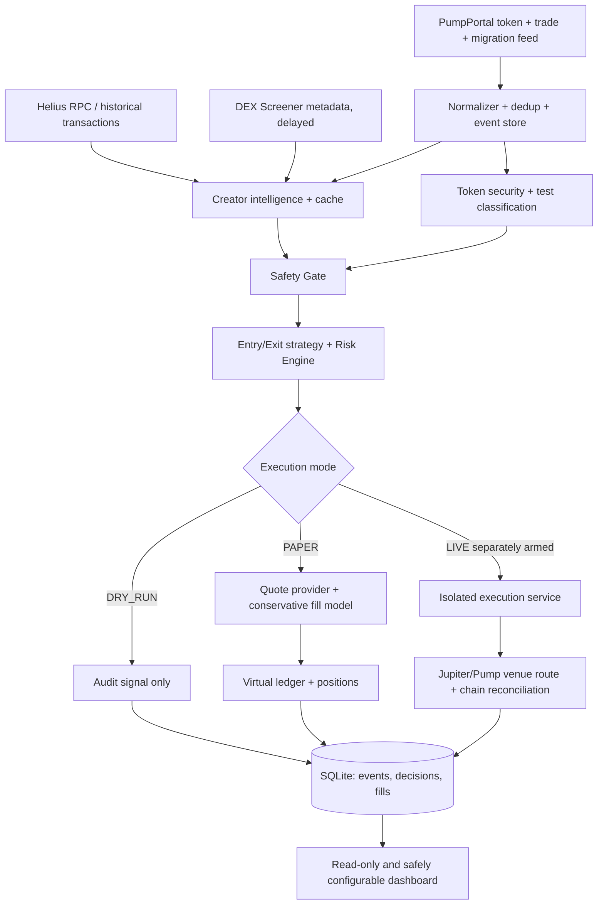

# 01 — System Architecture

## Data-flow diagram



## Bounded contexts

- **Ingestion:** maintain one PumpPortal socket, reconnect, persist checkpoints and normalized events, cap subscriptions.
- **Intelligence:** token and creator identity, past launches, wallet graph with evidence and cache invalidation.
- **Security:** deterministic per-token checks from chain state; unknown = not safe.
- **Strategy:** consumes immutable `MarketSnapshot` and `RiskReport`, produces `TradeIntent` independent of mode.
- **Execution:** `DryRunExecutor`, `PaperExecutor`, `LiveExecutor`; mutually exclusive capability profile.
- **Ledger:** append-only accounting; positions derived/reconciled; no floating-point settlements.
- **Control plane:** config version, admin changes, health, dashboard, local pause switch.

## Recommended directory layout

```text
apps/
  worker/             # new-token streaming, analysis, strategy
  api/                # health, audit, config API (no signing)
  web/                # React UI
  live-executor/      # optional, isolated service, NOT deployed in MVP
packages/
  domain/             # event schemas and order semantics
  providers/          # Helius, PumpPortal, DEX Screener, Jupiter adapters
  intelligence/       # creator/cache/wallet graph
  security/           # token safety + test token checks
  strategy/           # entry/exit/risk
  execution/          # interfaces and DRY_RUN executor
  paper/              # quote providers, simulation, virtual ledger
  storage/            # SQLite migrations / repositories
  config/             # Zod schema, config snapshots
  observability/      # metrics & logs
config/default.yaml
migrations/
fixtures/
tests/{unit,integration,replay,e2e}/
AGENTS.md
```

## Event and state boundaries

- `MarketEvent`: persisted with chain slot + upstream signature, source, received timestamp. Unique `(source, signature, event-index)` or stable synthetic ID.
- `TokenState`: `DISCOVERED → ANALYZING → {REJECTED | QUARANTINED | WATCHING | ELIGIBLE}`; revalidate as market changes.
- `OrderIntent`: `CREATED → RISK_CHECKED → {REJECTED | SUBMITTED}`; executor-specific transitions thereafter.
- `PAPER`: `QUOTE_REQUESTED → {UNFILLABLE | FILLED | EXPIRED}`. `FILLED` is simulated only.
- `LIVE`: `PREPARED → SIGNED → SUBMITTED → {CONFIRMED | FAILED | UNKNOWN}`. `UNKNOWN` requires reconciliation, not automatic resubmit.

## Architectural invariants

- Source ingestion never calls a live transaction method.
- Live signer and key storage are not available from worker/API processes.
- Ledger write and order state transition are in one transaction where possible.
- All on-chain prices are venue-, slot-, and timestamp-scoped.
- Provider adapters return typed `Result<T, ProviderError>` and include source metadata.
- Cache can accelerate historical context, but mint security must be checked for each new token.
- Use a durable queue only once one-process SQLite operations become a measurable bottleneck; do not introduce Redis by default.

## Latency engineering

Parallelize independent token and creator checks; use precomputed creator reputation; enforce max analysis timeout (quarantine on timeout). Track received_at vs chain slot timestamp separately. Never label hypothetical under-one-second targets as measured performance.

---
